# HW5. Агрегатные функции и операторы GROUP BY, HAVING.

## 1. COUNT()

### 1.1 Посчитать количество всех книг
```sql
SELECT COUNT(*) FROM books;
```

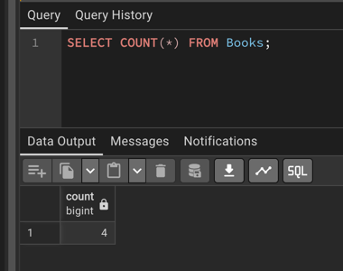

### 1.2 Посчитать количество всех авторов
```sql
SELECT COUNT(*) FROM Authors;
```

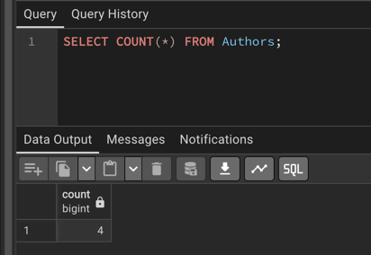

## 2. SUM

### 2.1 Посчитать сумму цен всех книг
```sql
SELECT SUM(price) FROM books;
```

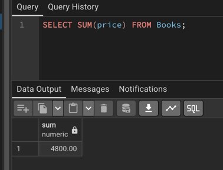

### 2.2 Посчитать общую сумму всех заказов
```sql
SELECT SUM(total_amount) FROM orders;
```

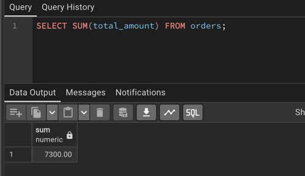

## 3. AVG

### 3.1 Посчитать среднюю цену книг
```sql
SELECT AVG(price) FROM books;
```

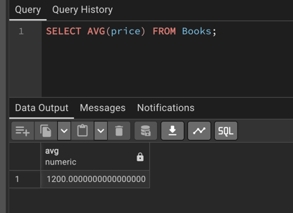

### 3.2 Посчитать среднюю общую цену заказов
```sql
SELECT AVG(total_amount) FROM orders;
```

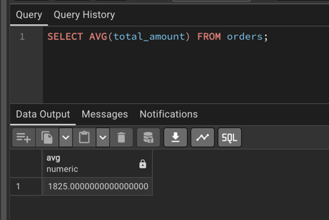

## 4. MIN

### 4.1 Найти минимальную цену книги
```sql
SELECT MIN(price) FROM books;
```

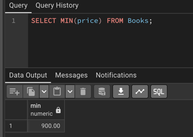

### 4.2 Найти минимальную общую цену заказа
```sql
SELECT MIN(total_amount) FROM orders;
```

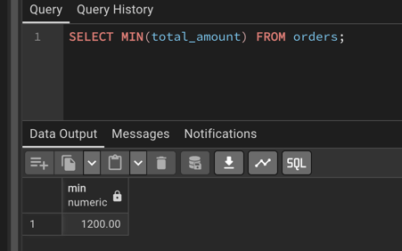

## 5. MAX

### 5.1 Найти максимальную цену книги
```sql
SELECT MAX(price) FROM books;
```

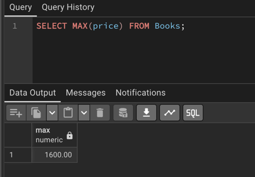

### 5.2 Найти максимальную общую цену заказа
```sql
SELECT MAX(total_amount) FROM orders;
```

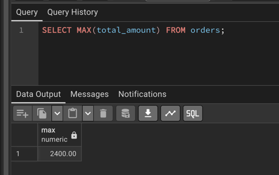

## 6. STRING_AGG

### 6.1 Вывести все названия книг, которые есть в таблице через запятую
```sql
SELECT STRING_AGG(title, ',') FROM books;
```
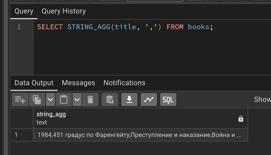

### 6.2 Вывести все категории книг через "|" 
```sql
SELECT STRING_AGG(name, '|') FROM categories;
```

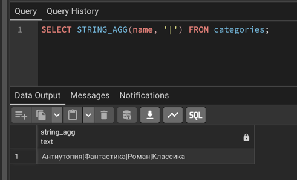

## 7. GROUP BY

### 7.1 Посчитать количество книг каждого автора
```sql
SELECT author_id, COUNT(*) AS book_count
FROM books
GROUP BY author_id;
```

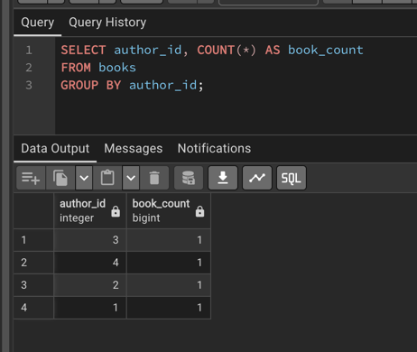
### 7.2 Посчитать среднюю цену книг в каждой категории
```sql
SELECT category_id, AVG(price) AS average_price
FROM books
GROUP BY category_id;
```

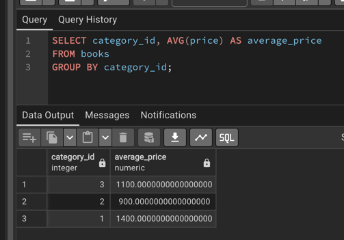

## 8. HAVING

### 8.1 Вывести категории, в которых больше одной книги
```sql
SELECT category_id, COUNT(*) AS book_count
FROM books
GROUP BY category_id
HAVING COUNT(*) > 1;
```

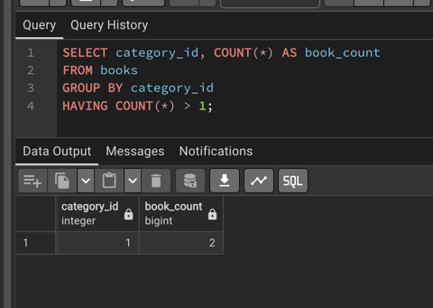

### 8.2 Вывести статусы заказов, по которым общая сумма превышает 2000 рублей
```sql
SELECT status, SUM(total_amount) AS total_sum
FROM orders
GROUP BY status
HAVING SUM(total_amount) > 2000;
```

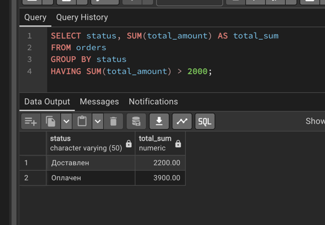

## 9. GROUPING SETS

### 9.1 Посчитать количество книг по авторам, по категориям и всего
```sql
SELECT author_id, category_id, COUNT(*) AS book_count
FROM books
GROUP BY GROUPING SETS ((author_id), (category_id), ());
```

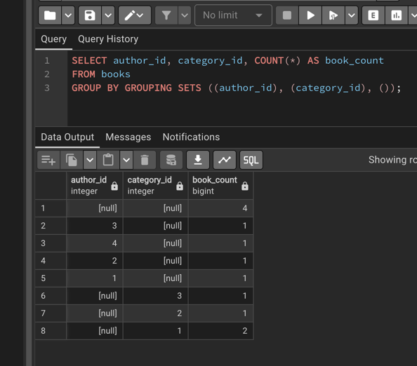

### 9.2 Посчитать суммы заказов по клиентам, по статусам и общую сумму
```sql
SELECT customer_id, status, SUM(total_amount) AS total_sum
FROM orders
GROUP BY GROUPING SETS ((customer_id), (status), ());
```

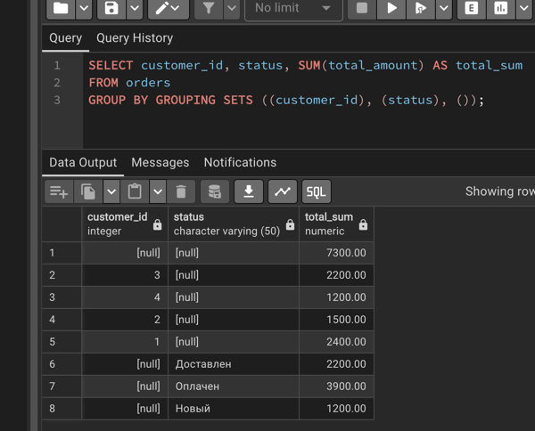

## 10. ROLLUP

### 10.1 Посчитать количество книг по авторам и категориям с итогами по авторам и общим итогом
```sql
SELECT author_id, category_id, COUNT(*) AS book_count
FROM books
GROUP BY ROLLUP(author_id, category_id);
```

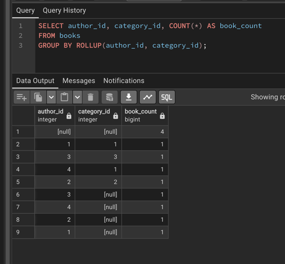

### 10.2 Посчитать суммы заказов по клиентам и статусам с промежуточными и общим итогами
```sql
SELECT customer_id, status, SUM(total_amount) AS total_sum
FROM orders
GROUP BY ROLLUP(customer_id, status);
```

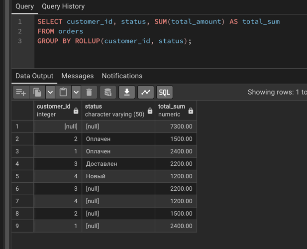

## 11. CUBE

### 11.1 Посчитать количество книг по всем вариантам группировки автора и категории
```sql
SELECT author_id, category_id, COUNT(*) AS book_count
FROM books
GROUP BY CUBE(author_id, category_id);
```

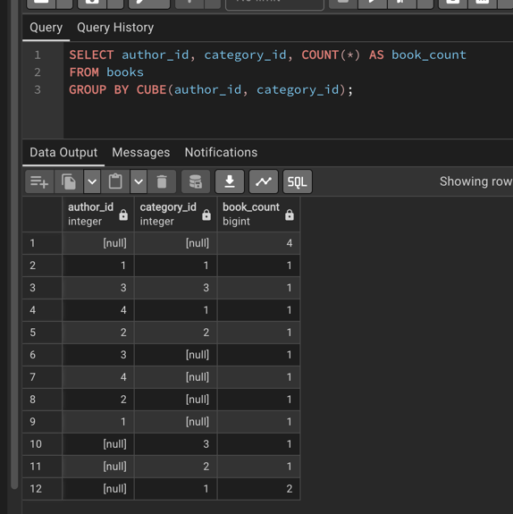
### 11.2 Посчитать суммы заказов по всем вариантам группировки клиента и статуса
```sql
SELECT customer_id, status, SUM(total_amount) AS total_sum
FROM orders
GROUP BY CUBE(customer_id, status);
```

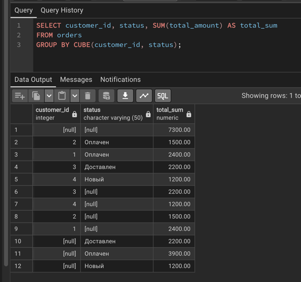
## 12. SELECT, FROM, WHERE, GROUP BY, HAVING, ORDER BY

### 12.1 Найти авторов, у которых есть книги дороже 1000 рублей, и их суммарная цена превышает 1100 рублей, и отсортировать по сумме
```sql
SELECT author_id, SUM(price) AS total_price
FROM books
WHERE price > 1000
GROUP BY author_id
HAVING SUM(price) > 1100
ORDER BY total_price DESC;
```

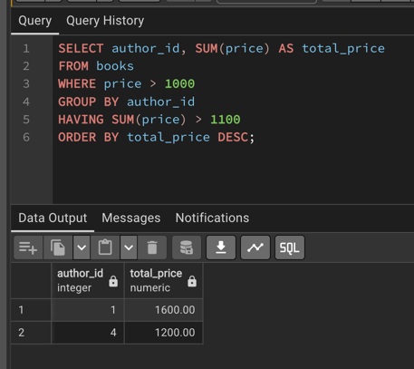
### 12.2 Вывести статусы заказов за сентябрь 2026 года с общей суммой больше 1000 рублей, отсортировав по сумме
```sql
SELECT status, SUM(total_amount) AS total_sum
FROM orders
WHERE order_date >= '2026-09-01' AND order_date < '2026-10-01'
GROUP BY status
HAVING SUM(total_amount) > 1000
ORDER BY total_sum DESC;
```

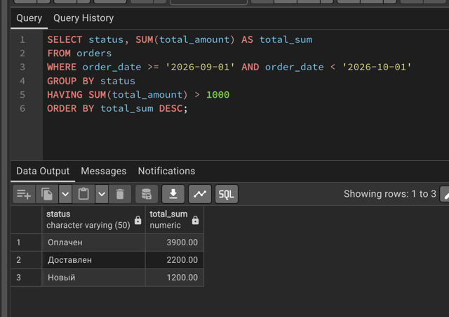