# HW6. Подзапросы.

## 1. Подзапрос в SELECT

### 1.1 Вывести названия книг, их цены и среднюю цену всех книг

```sql
SELECT title, price,
       (SELECT ROUND(AVG(price), 2) FROM books) AS avg_book_price
FROM books;
```

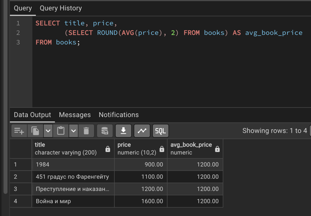


### 1.2 Вывести клиентов и общее количество заказов магазина

```sql
SELECT first_name, last_name,
       (SELECT COUNT(*) FROM orders) AS total_orders
FROM customers;
```

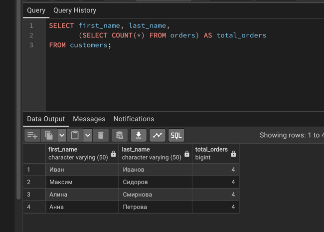


## 2. Подзапрос в FROM

### 2.1 Вывести среднюю цену книг каждого автора

```sql
SELECT author_id, avg_price
FROM (
    SELECT author_id, ROUND(AVG(price), 2) AS avg_price
    FROM books
    GROUP BY author_id
) AS author_prices
ORDER BY avg_price DESC;
```

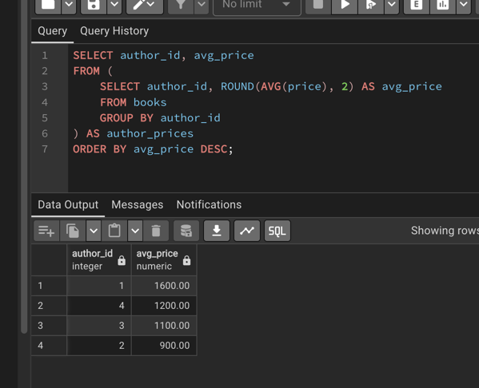


### 2.2 Вывести клиентов, у которых общая сумма заказов больше 1000 рублей

```sql
SELECT customer_id, total_spent
FROM (
    SELECT customer_id, SUM(total_amount) AS total_spent
    FROM orders
    GROUP BY customer_id
) AS customer_orders
WHERE total_spent > 1000;
```

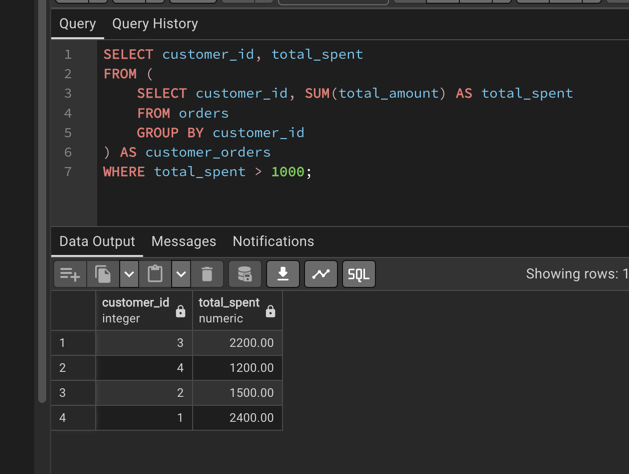


## 3. Подзапрос в WHERE

### 3.1 Найти книги дороже средней цены всех книг

```sql
SELECT title, price
FROM books
WHERE price > (SELECT AVG(price) FROM books);
```

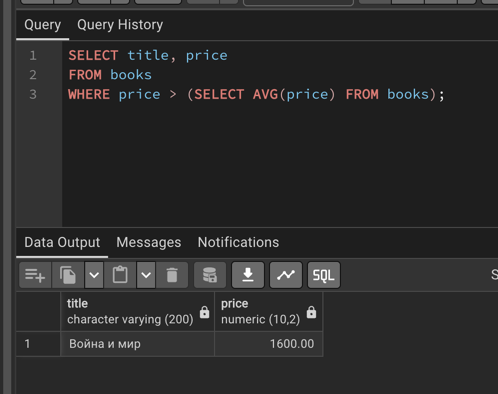


### 3.2 Вывести самые ранние заказы

```sql
SELECT id, order_date, total_amount
FROM orders
WHERE order_date = (SELECT MIN(order_date) FROM orders);
```

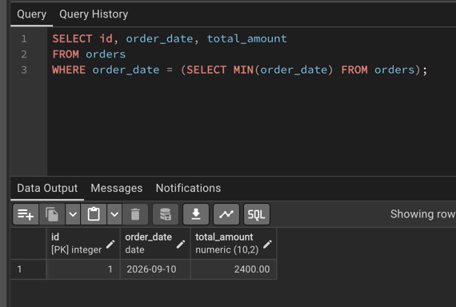


## 4. Подзапрос в HAVING

### 4.1 Найти категории, у которых средняя цена книг выше средней цены по магазину

```sql
SELECT category_id, ROUND(AVG(price), 2) AS avg_price
FROM books
GROUP BY category_id
HAVING AVG(price) > (SELECT AVG(price) FROM books);
```

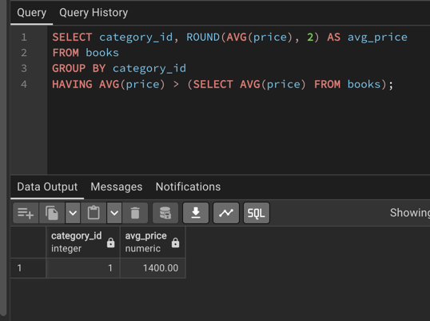


### 4.2 Вывести клиентов, чья общая сумма заказов больше среднего чека

```sql
SELECT customer_id, SUM(total_amount) AS total_spent
FROM orders
GROUP BY customer_id
HAVING SUM(total_amount) > (
    SELECT AVG(total_amount) FROM orders
);
```

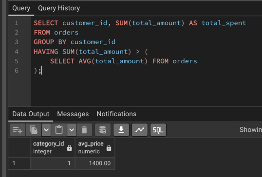


## 5. Оператор ALL

### 5.1 Найти самые дорогие книги в магазине

```sql
SELECT title, price
FROM books
WHERE price >= ALL (SELECT price FROM books);
```

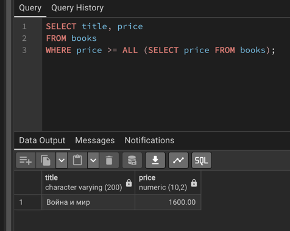


### 5.2 Найти авторов, книги которых ещё не добавлены в каталог

```sql
SELECT first_name, last_name
FROM authors
WHERE id <> ALL (
    SELECT author_id
    FROM books
    WHERE author_id IS NOT NULL
);
```

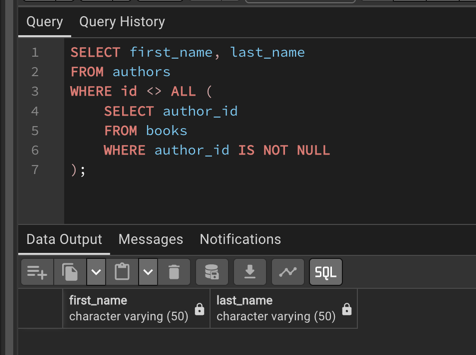


## 6. Оператор IN

### 6.1 Вывести авторов, у которых есть книги дороже 1000 рублей

```sql
SELECT first_name, last_name
FROM authors
WHERE id IN (
    SELECT author_id
    FROM books
    WHERE price > 1000
);
```

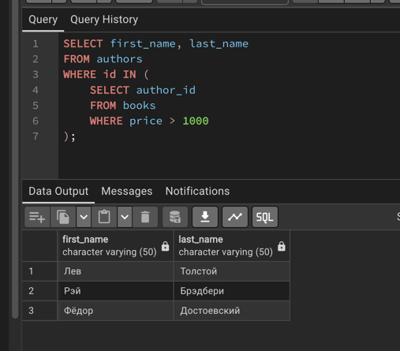


### 6.2 Найти книги, которые хотя бы раз заказывали

```sql
SELECT title, price
FROM books
WHERE id IN (SELECT book_id FROM order_items);
```

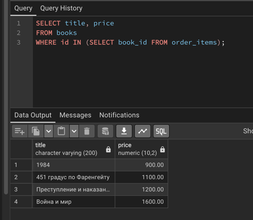


## 7. Оператор ANY

### 7.1 Вывести книги, которые дороже хотя бы одной книги в магазине

```sql
SELECT title, price
FROM books
WHERE price > ANY (SELECT price FROM books);
```


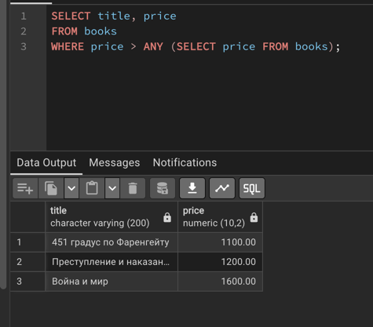


### 7.2 Вывести клиентов, которые сделали хотя бы один заказ

```sql
SELECT first_name, last_name
FROM customers
WHERE id = ANY (SELECT customer_id FROM orders);
```


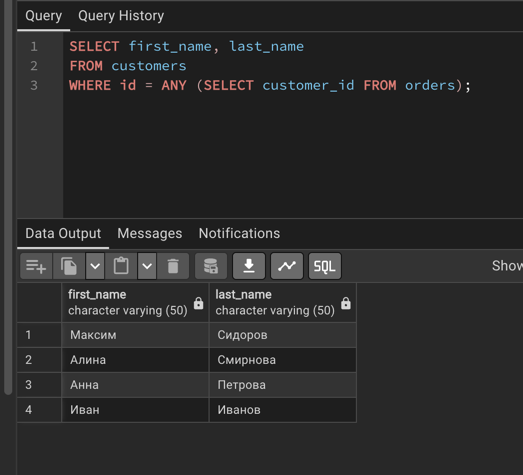


## 8. Операторы EXISTS и NOT EXISTS

### 8.1 Вывести авторов, у которых есть хотя бы одна книга

```sql
SELECT a.first_name, a.last_name
FROM authors AS a
WHERE EXISTS (
    SELECT 1
    FROM books AS b
    WHERE b.author_id = a.id
);
```

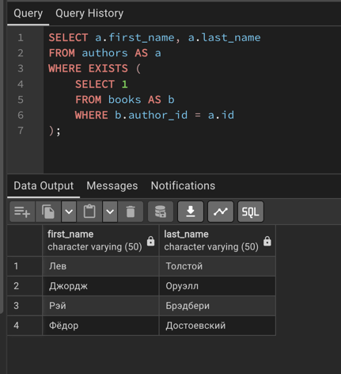


### 8.2 Вывести клиентов, которые ещё не делали заказы

```sql
SELECT c.first_name, c.last_name
FROM customers AS c
WHERE NOT EXISTS (
    SELECT 1
    FROM orders AS o
    WHERE o.customer_id = c.id
);
```

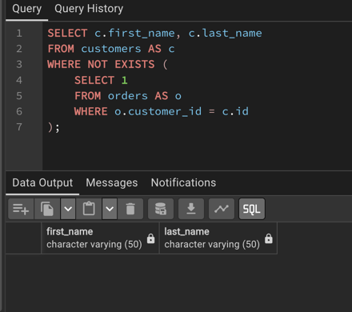


## 9. Сравнение по нескольким столбцам

### 9.1 Вывести самые дорогие книги каждого автора

```sql
SELECT title, author_id, price
FROM books
WHERE (author_id, price) IN (
    SELECT author_id, MAX(price)
    FROM books
    GROUP BY author_id
);
```

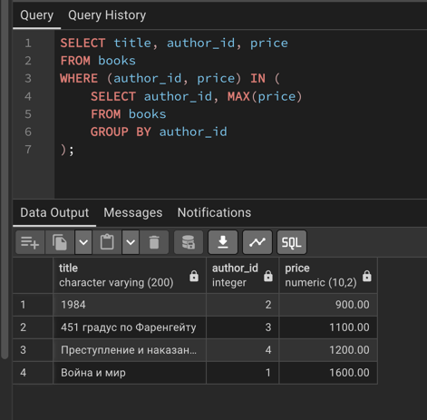


### 9.2 Вывести заказы с максимальной суммой для каждого клиента

```sql
SELECT id, customer_id, total_amount
FROM orders
WHERE (customer_id, total_amount) IN (
    SELECT customer_id, MAX(total_amount)
    FROM orders
    GROUP BY customer_id
);
```

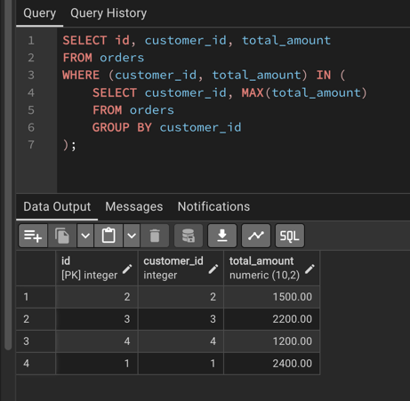


## 10. Коррелированные подзапросы

### 10.1 Посчитать количество книг у каждого автора

```sql
SELECT a.first_name, a.last_name,
       (SELECT COUNT(*)
        FROM books AS b
        WHERE b.author_id = a.id) AS book_count
FROM authors AS a;
```

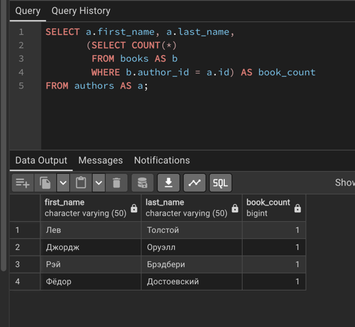


### 10.2 Посчитать количество заказов у каждого клиента

```sql
SELECT c.first_name, c.last_name,
       (SELECT COUNT(*)
        FROM orders AS o
        WHERE o.customer_id = c.id) AS order_count
FROM customers AS c;
```

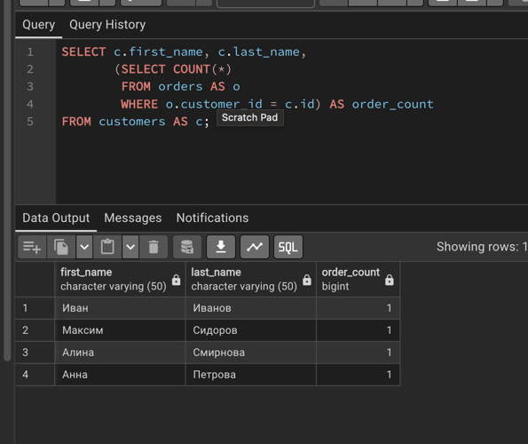


### 10.3 Найти книги дороже средней цены в своей категории

```sql
SELECT b.title, b.price, b.category_id
FROM books AS b
WHERE b.price > (
    SELECT AVG(b2.price)
    FROM books AS b2
    WHERE b2.category_id = b.category_id
);
```

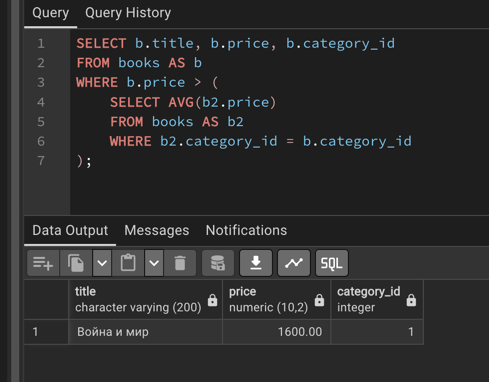


### 10.4 Найти заказы дороже среднего заказа того же клиента

```sql
SELECT o.id, o.customer_id, o.total_amount
FROM orders AS o
WHERE o.total_amount > (
    SELECT AVG(o2.total_amount)
    FROM orders AS o2
    WHERE o2.customer_id = o.customer_id
);
```

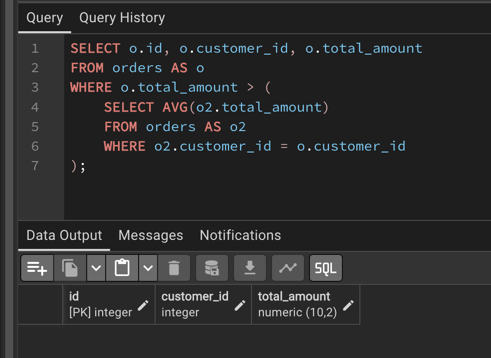


### 10.5 Найти самую дорогую книгу каждого автора

```sql
SELECT b.title, b.author_id, b.price
FROM books AS b
WHERE b.price = (
    SELECT MAX(b2.price)
    FROM books AS b2
    WHERE b2.author_id = b.author_id
);
```

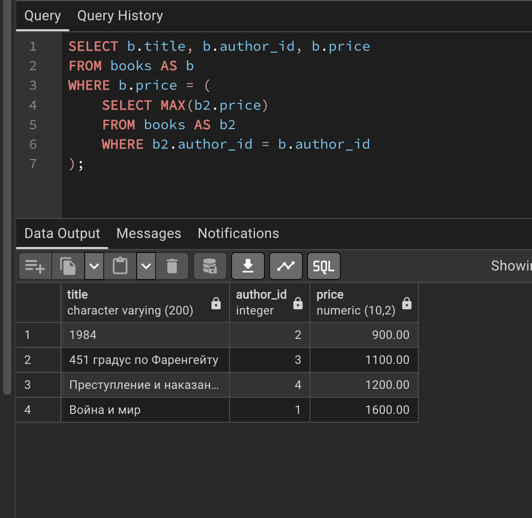
