# HW7. CTE, UNION и оконные функции.

## 1. CTE (WITH)

### 1.1 Вывести количество книг каждого автора

```sql
WITH author_stats AS (
    SELECT author_id, COUNT(*) AS book_count
    FROM books
    GROUP BY author_id
)
SELECT a.first_name, a.last_name, s.book_count
FROM authors AS a
JOIN author_stats AS s ON a.id = s.author_id
ORDER BY s.book_count DESC;
```

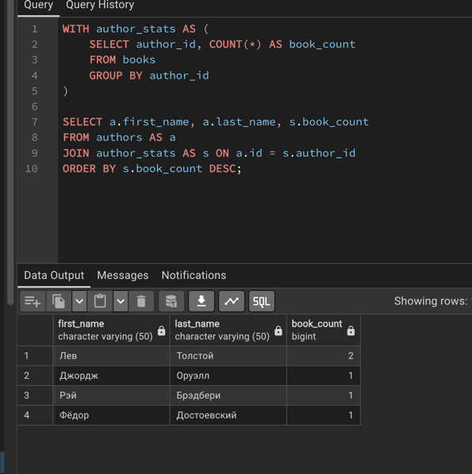

### 1.2 Вывести количество заказов и общую сумму покупок каждого клиента

```sql
WITH customer_stats AS (
    SELECT customer_id,
           COUNT(*) AS order_count,
           SUM(total_amount) AS total_spent
    FROM orders
    GROUP BY customer_id
)
SELECT c.first_name, c.last_name,
       s.order_count, s.total_spent
FROM customers AS c
JOIN customer_stats AS s ON c.id = s.customer_id
ORDER BY s.total_spent DESC;
```

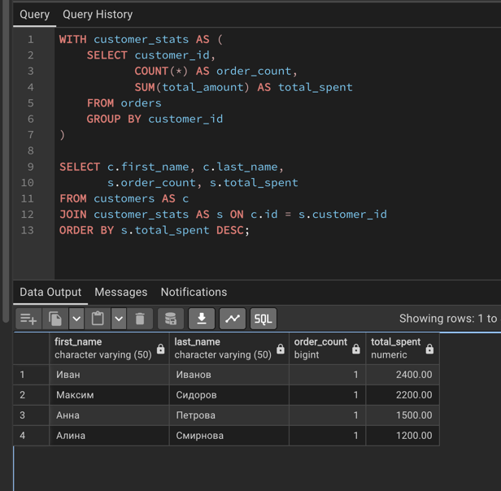

### 1.3 Вывести количество проданных экземпляров и выручку по каждой книге

```sql
WITH book_sales AS (
    SELECT book_id,
           SUM(quantity) AS sold_quantity,
           SUM(quantity * price) AS sales_total
    FROM order_items
    GROUP BY book_id
)
SELECT b.title,
       COALESCE(s.sold_quantity, 0) AS sold_quantity,
       COALESCE(s.sales_total, 0) AS sales_total
FROM books AS b
LEFT JOIN book_sales AS s ON b.id = s.book_id
ORDER BY sold_quantity DESC;
```

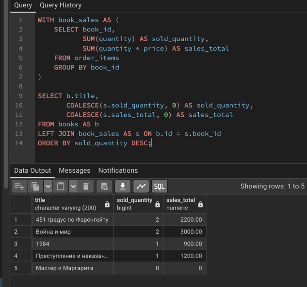

## 2. UNION, INTERSECT, EXCEPT

### 2.1 Объединить имена авторов и покупателей

```sql
SELECT first_name AS name
FROM authors
UNION
SELECT first_name
FROM customers
ORDER BY name;
```

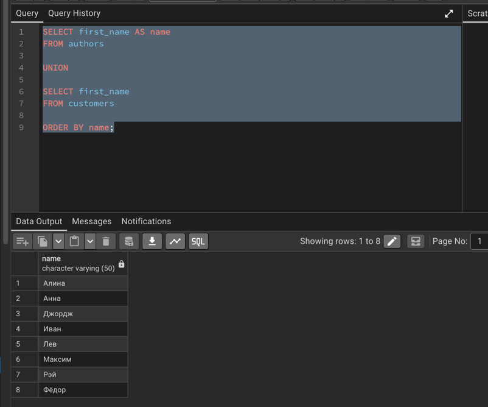

### 2.2 Найти покупателей, у которых есть заказ дороже 1500 рублей и которые зарегистрировались до 5 сентября 2026 года

```sql
SELECT first_name || ' ' || last_name AS customer_name
FROM customers
WHERE id IN (
    SELECT customer_id
    FROM orders
    WHERE total_amount > 1500
    INTERSECT
    SELECT id
    FROM customers
    WHERE registration_date < DATE '2026-09-05'
);
```

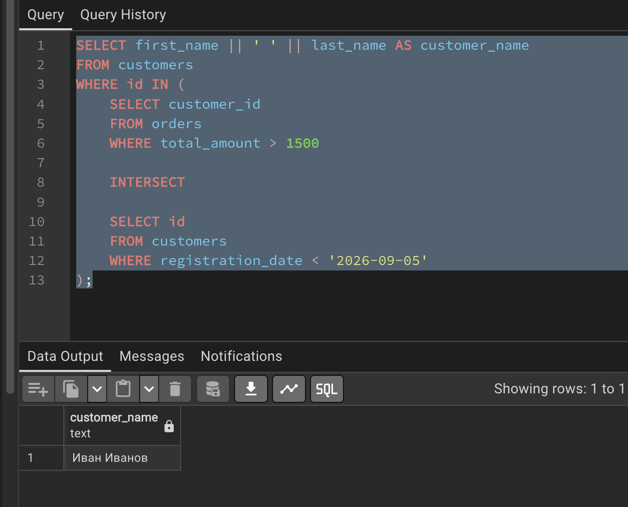

### 2.3 Найти книги, которые ещё ни разу не покупали

```sql
SELECT title
FROM books
EXCEPT
SELECT b.title
FROM books AS b
JOIN order_items AS oi ON b.id = oi.book_id;
```

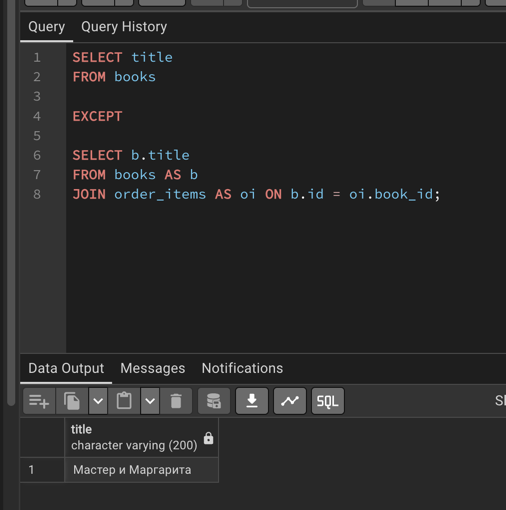

## 3. PARTITION BY

### 3.1 Вывести количество книг каждого автора с отображением всех книг

```sql
SELECT title, author_id,
       COUNT(*) OVER (PARTITION BY author_id) AS book_count
FROM books
ORDER BY author_id;
```

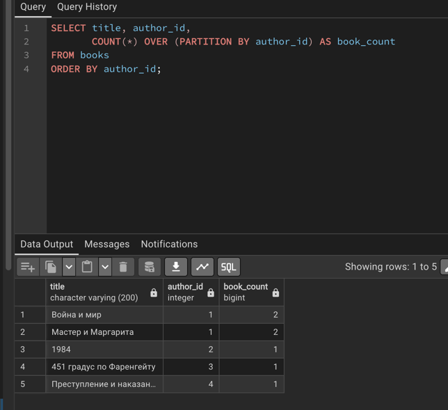

### 3.2 Вывести общую сумму заказов с одинаковым статусом

```sql
SELECT id, status, total_amount,
       SUM(total_amount) OVER (PARTITION BY status) AS status_total
FROM orders
ORDER BY status;
```

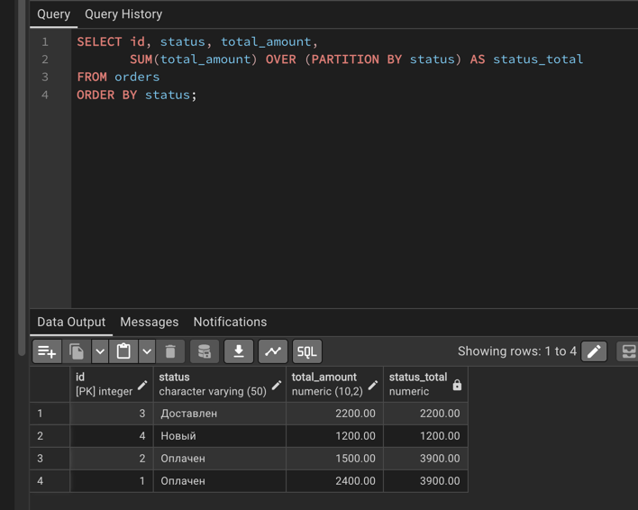

## 4. PARTITION BY + ORDER BY

### 4.1 Вывести накопительное количество проданных экземпляров каждой книги

```sql
SELECT book_id, order_id, quantity,
       SUM(quantity) OVER (
           PARTITION BY book_id
           ORDER BY order_id
       ) AS total_sold
FROM order_items
ORDER BY book_id, order_id;
```

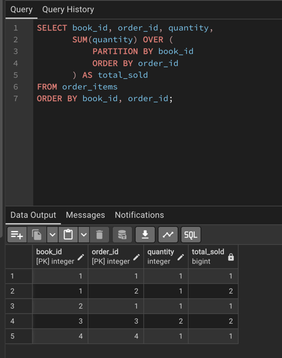

### 4.2 Вывести накопительную стоимость товаров внутри каждого заказа

```sql
SELECT order_id, book_id, quantity, price,
       SUM(quantity * price) OVER (
           PARTITION BY order_id
           ORDER BY book_id
       ) AS total_amount
FROM order_items
ORDER BY order_id, book_id;
```

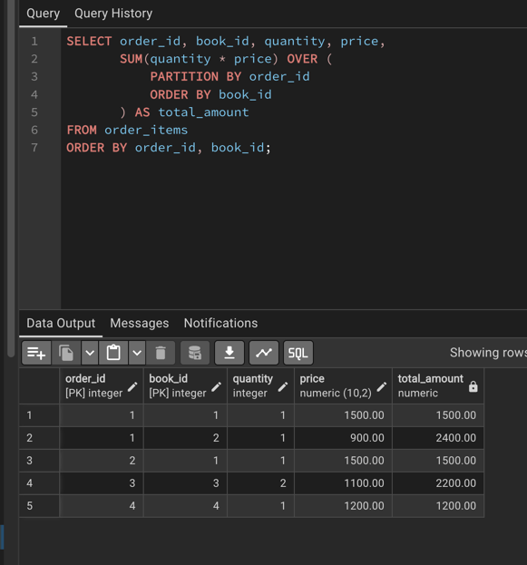

## 5. ROWS

### 5.1 Вывести накопительную сумму всех заказов по дате

```sql
SELECT id, order_date, total_amount,
       SUM(total_amount) OVER (
           ORDER BY order_date
           ROWS BETWEEN UNBOUNDED PRECEDING AND CURRENT ROW
       ) AS running_total
FROM orders;
```

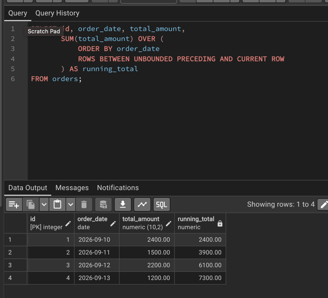

### 5.2 Вывести среднюю цену текущей и предыдущей книги

```sql
SELECT title, price,
       ROUND(
           AVG(price) OVER (
               ORDER BY price, id
               ROWS BETWEEN 1 PRECEDING AND CURRENT ROW
           ), 2
       ) AS avg_price
FROM books;
```

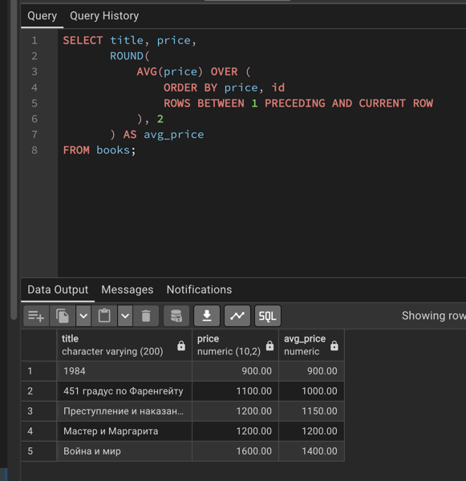

## 6. RANGE

### 6.1 Вывести среднюю цену книг в диапазоне от текущей цены до 300 рублей дешевле

```sql
SELECT title, price,
       ROUND(
           AVG(price) OVER (
               ORDER BY price
               RANGE BETWEEN 300 PRECEDING AND CURRENT ROW
           ), 2
       ) AS avg_price
FROM books;
```

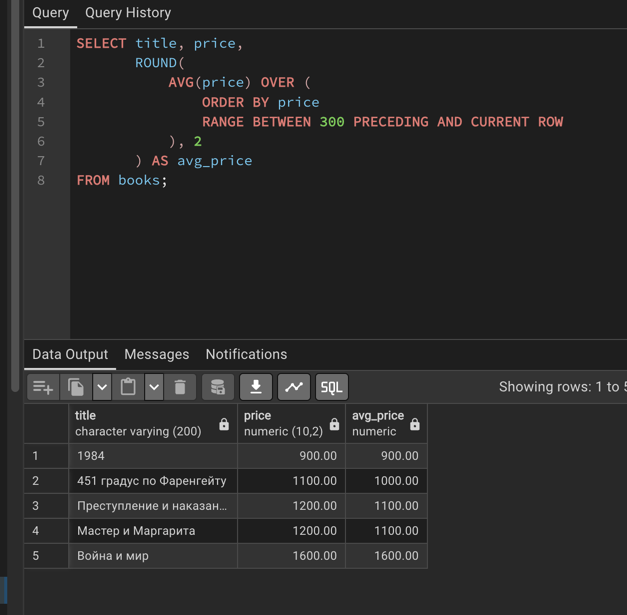

### 6.2 Вывести количество книг в диапазоне от текущей цены до 300 рублей дороже

```sql
SELECT title, price,
       COUNT(*) OVER (
           ORDER BY price
           RANGE BETWEEN CURRENT ROW AND 300 FOLLOWING
       ) AS book_count
FROM books;
```

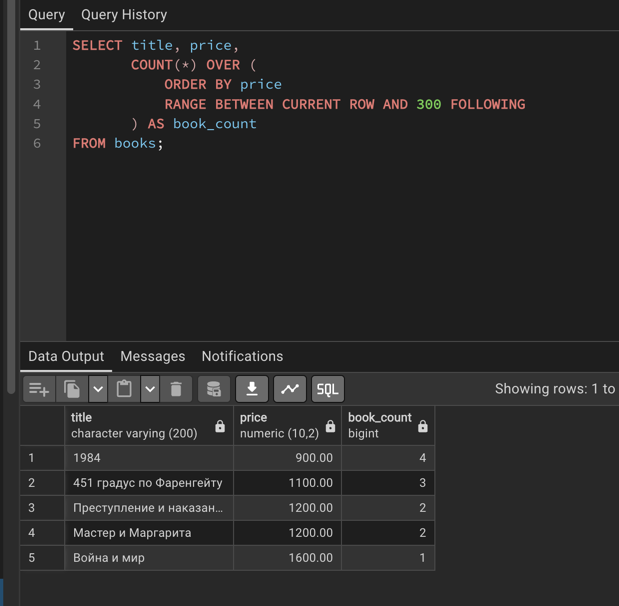

## 7. Ранжирующие оконные функции

### 7.1 ROW_NUMBER — пронумеровать книги по убыванию цены

```sql
SELECT title, price,
       ROW_NUMBER() OVER (ORDER BY price DESC, id) AS row_num
FROM books;
```

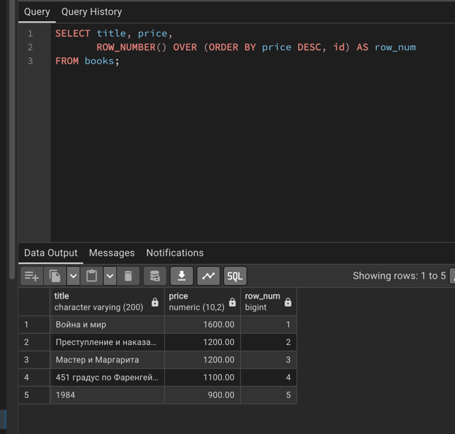

### 7.2 RANK — присвоить ранг книгам по цене

```sql
SELECT title, price,
       RANK() OVER (ORDER BY price DESC) AS book_rank
FROM books;
```

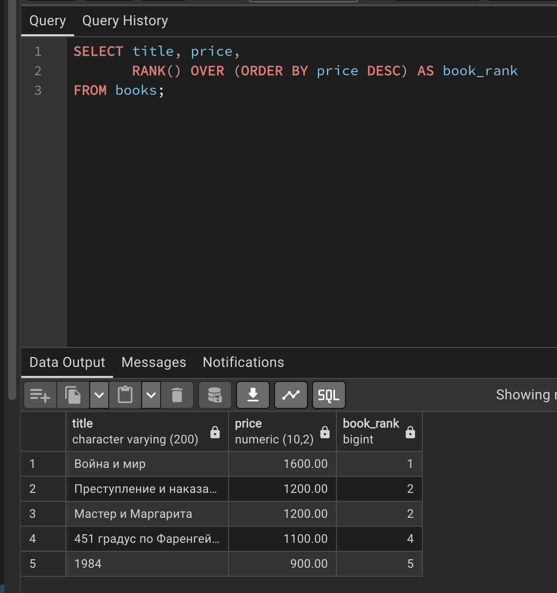

### 7.3 DENSE_RANK — присвоить ранг без пропусков

```sql
SELECT title, price,
       DENSE_RANK() OVER (ORDER BY price DESC) AS book_rank
FROM books;
```

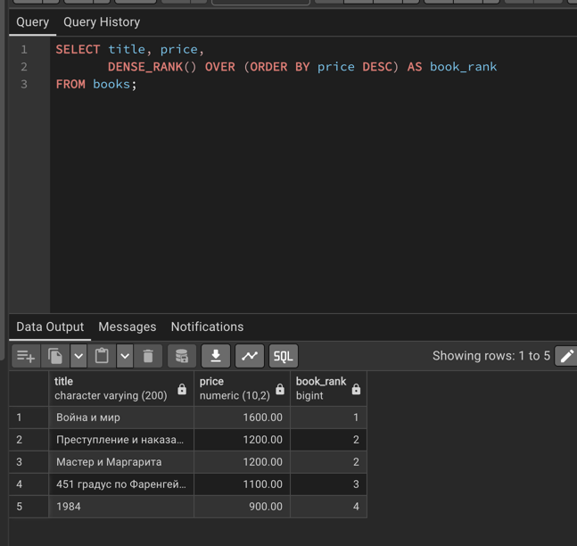

## 8. Функции смещения

### 8.1 LAG — вывести цену предыдущей книги

```sql
SELECT title, price,
       LAG(price) OVER (ORDER BY price, id) AS previous_price
FROM books;
```

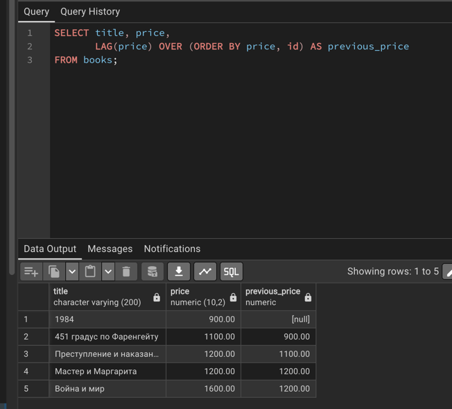

### 8.2 LEAD — вывести цену следующей книги

```sql
SELECT title, price,
       LEAD(price) OVER (ORDER BY price, id) AS next_price
FROM books;
```

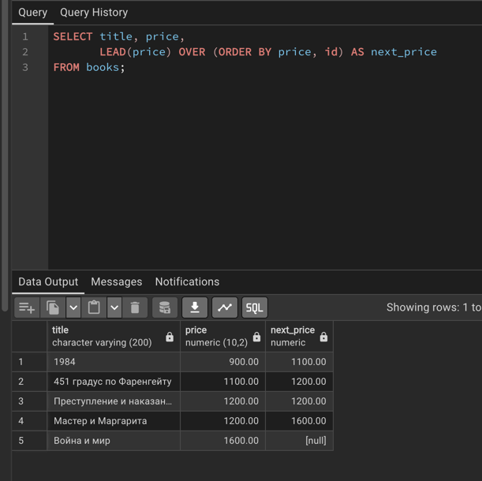

### 8.3 FIRST_VALUE — вывести самую дорогую книгу каждой категории

```sql
SELECT title, category_id,
       FIRST_VALUE(title) OVER (
           PARTITION BY category_id
           ORDER BY price DESC
       ) AS most_expensive
FROM books;
```

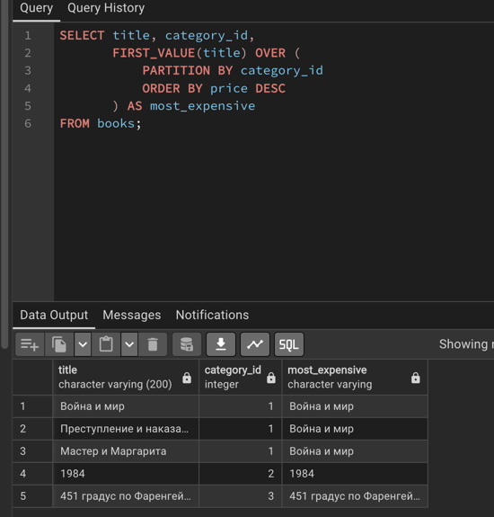

### 8.4 LAST_VALUE — вывести самую дешёвую книгу каждой категории

```sql
SELECT title, category_id,
       LAST_VALUE(title) OVER (
           PARTITION BY category_id
           ORDER BY price DESC
           ROWS BETWEEN UNBOUNDED PRECEDING AND UNBOUNDED FOLLOWING
       ) AS cheapest
FROM books;
```

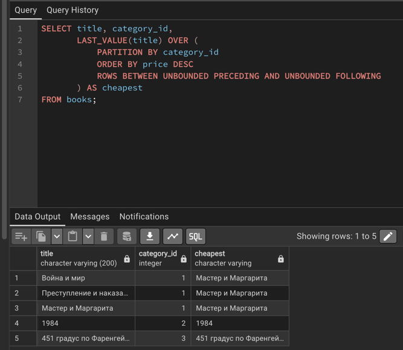
